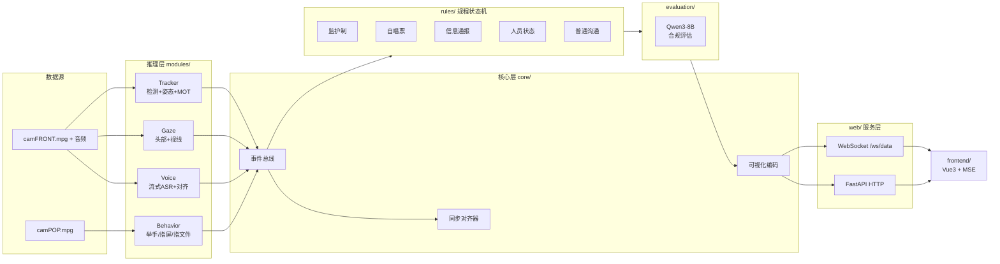

# 核电站监护制合规检测系统

> 核电站主控室场景下的多模态合规性实时检测系统：分析 front（正面）与 pop（操作盘）两路音视频，判定操作人 / 监护人是否按规程执行监护制、自唱票与信息通报等既定流程，检测结果由大模型对完整流程的多模态证据链进行合规评估，前端流式可视化呈现。
>
> 系统内建：监护制 / 自唱票 / 信息通报 / 人员状态 / **普通沟通** 五类规程状态机；语音转写采用**流式流水线**（增量读音频 + 在线 VAD 切片 + 跨段成句 + 保护词）；对话关键词标红、同句应答、"被新沟通顶掉"语义、前端流程通知同秒稳定排序。逐条改动记录见 `RELEASE.md`。

| 后端 | Python 3.10 · FastAPI · Redis Stream+Hash · ffmpeg fMP4 |
|------|------|
| 前端 | Vue 3 · TypeScript · Vite · ESLint + Prettier · MSE 流式播放 |
| 感知 | YOLO11 检测 · YOLO26s 姿态 · OC-SORT 跟踪 · Qwen3-ASR 流式语音对齐 · Qwen3-8B 评估 |
| 代码规模 | 58 个 Python 文件 / 约 15,000 行 · 27 个前端源文件 / 约 2,600 行 |

---

## 目录

- [系统架构](#系统架构)
- [核心能力](#核心能力)
- [环境要求](#环境要求)
- [准备资源](#准备资源)
- [部署指南](#部署指南)
- [配置参考](#配置参考)
- [接口参考](#接口参考)
- [推送与交互逻辑](#推送与交互逻辑)
- [语音流式流水线](#语音流式流水线)
- [普通沟通流程](#普通沟通流程)
- [项目结构](#项目结构)
- [故障排查](#故障排查)
- [开发说明](#开发说明)
- [贡献指南](#贡献指南)
- [许可证](#许可证)

---

## 系统架构



**关键设计点**

- **事件总线解耦**：各推理模块只向总线发布事件，规程状态机被动消费，模块可独立增删；规则由 `RuleRegistry.discover()` 扫描 `rules/` 目录自动发现注册。
- **视角级 GPU 分配**：`config.yaml` 按模块指定 GPU；默认 `tracker` 独占 GPU 0，`voice` / `behavior` / `evaluation`（约 16GB）共用 GPU 1（单卡环境请将 `gpu_map` 中非 0 值全部改为 `"0"` 并关闭高耗模块）。
- **语音块级流式**：ffmpeg 管道增量读音频 → 在线 VAD 切片 → 逐段解码即出 → 跨段全局词流成句，**保留字级时间戳**（下游对齐/判定/渲染全部依赖时间戳）。
- **推理解耦常驻**：`main.py` 以子进程拉起各推理流，Web 服务常驻；进程异常不影响 HTTP 面。
- **状态可回放**：Redis 记录推理与模块状态，WebSocket 连接时补发状态快照，前端刷新即恢复进度。

---

## 核心能力

| 模块 | 能力 | 说明 |
|------|------|------|
| Tracker | 人员追踪 | 目标检测 + 姿态估计 + 多目标跟踪，输出操作人 / 监护人身份 |
| Gaze | 眼睛关注度 | 头部姿态 + 视线估计，判定是否注视关键区域 |
| Voice | 语音转录 | **流式流水线**：增量读音频 + 在线切片 + 跨段成句 + 字词级时间对齐 + 行业术语归一化，支撑唱票比对 |
| Behavior | 行为检测 | 举手、手指屏幕、手指文件三类关键动作 |
| Rules | 规程判定 | 监护制 / 自唱票 / 信息通报 / 人员状态 / **普通沟通** 五大状态机实时研判 + 违规告警 |
| Evaluation | 合规评估 | 大模型基于完整多模态证据链输出合规结论与打分 |
| Frontend | 流式可视化 | 视频、字幕（关键词标红）、关注度热力图、告警实时推送，断点续看，流程通知同秒稳定排序 |

---

## 环境要求

| 组件 | 要求 |
|------|------|
| Python | 3.10 |
| GPU | NVIDIA + CUDA，**需双卡**（合计显存 ~28~30GB；evaluation ~16GB / tracker ~2~4GB / behavior ~4GB / voice ~2~4GB） |
| Redis | 6.x+，需支持 Stream 与 Hash |
| Node | 20（仅前端构建阶段） |
| ffmpeg | 系统可用（fMP4 转封装 + 音频管道增量抽取） |

---

## 准备资源

> 以下模型权重与输入视频不包含在代码仓库内，需按指定路径自行准备。判定逻辑的权威来源为 `rules/` 源码，规程细则与设计文档需向项目方单独获取。

### 模型权重 → `models/`

| 路径 | 用途 |
|------|------|
| `detection/yolo11_MOT.pt` | 人员检测（含 MOT 跟踪头） |
| `detection/yolo26s-pose.pt` | 姿态估计 |
| `behavior/behavior_yolo.pt` | 行为检测 |
| `behavior/behavior_yolo26s-pose.pt` | 行为姿态估计 |
| `gaze/yolov8n_head.onnx` | 头部检测 |
| `gaze/gazelle_dinov3_vits16plus_finetuned_1x3x640x640_1xNx4.onnx` | 视线估计 |
| `evaluation/Qwen3-8B` | 合规评估主模型 |
| `evaluation/Qwen2.5-1.5B-Instruct` | 备用评估模型 |
| `voice/qwen/Qwen3-ASR-0.6B` | 语音转录（如有微调权重可将 `voice.model_path` 指向之） |
| `voice/qwen/Qwen3-ForcedAligner-0.6B` | 字词级对齐 |

- Qwen 系列为公开模型，可从 ModelScope / HuggingFace 获取。
- YOLO 系列为项目训练产物，需自行训练或使用项目方提供的权重。

> ⚠️ **命名差异**：语音模型目录名可能用下划线（`Qwen3-ASR-0___6B`），而 `config.yaml` 中写的是带点形式（`Qwen3-ASR-0.6B`）。下载后必须核对并统一，否则启动即报错。

### 视频与标注 → `data/`

| 路径 | 说明 |
|------|------|
| `videos/camFRONT.mpg` | 正面视角视频，操作人 / 监护人入镜（`videos.front` 可指向任意本地视频文件） |
| `videos/camPOP.mpg` | 操作盘视角视频 |
| `videos/camFRONT_audio.wav` | 正面视角音频轨 |
| `ROI.json` | 关键区域标注，关注度判定依据 |
| `results/` | 推理结果输出目录（需可写，自动创建） |

样本数据为本项目自采，无法随仓库发布。替换为自有视频后须同步修改 `config.yaml` 的 `videos.*`。

### Redis 实例

建议使用**专用 Redis**：`/start` 接口会执行 `flushdb` 清空全部 key 以保证运行幂等，请勿与业务服务共用实例。

---

## 部署指南

### 1. 获取代码

```bash
git clone <your-repo-url>
cd <your-repo-dir>
```

后续命令均在仓库根目录执行。

### 2. 安装依赖

```bash
conda create -n hedian python=3.10 -y
conda activate hedian
pip install -r requirements.txt
```

### 3. 放置资源

按 [准备资源](#准备资源) 补齐 `models/` 与 `data/`，并核对 `config.yaml` 中所有路径指向真实文件。

### 4. 启动后端

```bash
python main.py --gpu 0            # 前台，便于观察日志
python main.py --config custom.yaml --gpu 0   # 指定配置
```

常驻部署：

```bash
setsid nohup python main.py --gpu 0 > hedian.log 2>&1 < /dev/null &
```

### 5. 构建前端

```bash
cd frontend
npm install
npm run build
```

构建产物**不入版本库**（`frontend/dist/` 已加入 `.gitignore`），克隆仓库后必须执行本步才能在浏览器访问页面。产物由后端以静态文件兜底方式托管，无需独立部署 Web 服务器。

### 6. 验证

```bash
curl http://127.0.0.1:5002/status      # 期望 {"pipeline":"idle", "ws_clients":0}
curl -X POST http://127.0.0.1:5002/start
curl http://127.0.0.1:5002/api/modules  # 确认各模块开关
```

浏览器访问 `http://<服务地址>:5002`。

### 停止 / 复位

```bash
curl -X POST http://127.0.0.1:5002/stop    # 终止推理子进程，切回 idle
curl -X POST http://127.0.0.1:5002/reset   # 同时清空 Redis 与可视化缓存
pkill -f main.py                            # 直接结束服务
```

---

## 配置参考

`config.yaml` 主要字段：

| 字段 | 默认 | 说明 |
|------|------|------|
| `app.port` | `5002` | Web 服务端口 |
| `app.gpu_map` | tracker=0；voice / behavior / evaluation=1 | **单卡环境请将值 `"1"` 改为 `"0"`**；双卡部署时 tracker 独占 GPU 0，voice / behavior 与约 16GB 的 evaluation 共置 GPU 1 |
| `app.gpu_default` | `"0"` | `gpu_map` 未覆盖模块的回退值，含 CLI `--gpu` |
| `app.fps` | `30.0` | 帧率基准 |
| `redis.host` / `port` / `db` | `localhost` / `6379` / `0` | Redis 连接 |
| `paths.data_root` | `data` | 数据根目录 |
| `paths.model_root` | `models` | 模型根目录 |
| `paths.result_root` | `data/results` | 结果输出目录 |
| `videos.front` / `pop` | `data/videos/camFRONT.mpg` / `camPOP.mpg` | 输入视频路径（front 与 pop 可指向同一文件） |
| `voice.sentence_gap_sec` | `1.0` | 句边界停顿阈值，**必须 ≥ `vad_min_silence_sec(0.8)`**，否则岗位词会被句边界切开 |
| `voice.asr_engine` | `qwen3` | 语音识别引擎 |
| `voice.model_path` / `aligner_path` | 见仓库 | 语音模型路径 |
| `voice.vad_noise_db` 等五项 | `-35.0` / `0.8` / `0.2` / `0.35` / `30.0` | VAD 分段参数（对齐评估链路） |
| `voice.stream_block_sec` | `0.2` | 音频管道单次读取块时长，越小首包延迟越低 |
| `voice.segmenter` | `silence_vad` | 切片策略：`silence_vad`（在线 VAD）\| `fixed_window`（固定窗+重叠） |
| `voice.boundary_overlap_sec` | `0.4` | 段间左上下文重叠；重叠区重复解码，由全局词流按时间戳去重 |
| `voice.vad_split_search_sec` / `vad_split_margin_db` | `1.0` / `6.0` | 超长强制切分时在回看窗口内挑能量最低点切分（词边界保护） |
| `voice.max_sentence_sec` | `30.0` | 跨段句子组装上限，超长强制封句 |
| `voice.protected_words` | `null` | 保护词（不可被句边界切开）：`null`=自动从关键词表派生 / `[]`=关闭 / 列表=自定义 |
| `voice.protected_hold_sec` | `2.0` | 句尾为保护词未完成前缀时的最大挂起秒数 |
| `voice.fixed_window_sec` / `fixed_window_overlap_sec` | `20.0` / `5.0` | 仅 `segmenter=fixed_window` 时生效 |
| `supervision.*` | 见仓库 | 监护制绑定的时长与距离阈值、连续帧数、告警冷却 |
| `tracker.detection.*` | 见仓库 | 检测置信度、NMS、输入尺寸 |
| `gaze.*` / `behavior.*` | 见仓库 | 关注度与行为判定的置信度、IoU、冷却参数 |
| `bus.max_queue_size` | `1024` | 事件总线队列上限 |
| `modules.*` | `true` | 各感知模块开关，未备齐资源的模块可置 `false` |
| `rules.*` | `true` | 各规程状态机开关（含 `normal_comm`） |

---

## 接口参考

### HTTP

| 方法 | 路径 | 说明 |
|------|------|------|
| POST | `/start` | 启动流水线。幂等：运行中重复调用返回 `already_running`；启动前 `flushdb` 清空历史 |
| POST | `/stop` | 终止推理子进程，清理 `inference:*` / `module:*` / `pipeline:*`，状态切回 idle |
| POST | `/reset` | 页面刷新场景：终止进程 + `flushdb` + 清空可视化缓存 |
| GET | `/status` | 返回 `{pipeline, ws_clients}` |
| GET | `/api/config` | 返回当前生效的完整配置 |
| GET | `/api/modules` | 返回模块开关 |
| GET | `/api/video/front` | 流式下发正面视角视频（HTTP Range 206 硬解） |
| GET | `/api/video/pop` | 流式下发操作盘视角视频 |

静态资源兜底至前端 `dist/`（需先执行部署指南第 5 步构建），并强制 `no-cache` 响应头，避免部署后取到旧产物。

### WebSocket `ws://<host>:5002/ws/data`

- **下行**：服务端推送推理事件、字幕、关注度与告警数据；连接建立时补发状态快照，刷新页面即可恢复进度。
- **上行**：客户端上报播放进度 `{ "type": "playback_progress", "current_sec": 12.5 }`，用于多端同步。

---

## 推送与交互逻辑

- **消息通道**：WebSocket 下行分两类——二进制视频帧（fMP4 分片）与 JSON 结构化数据；上行仅播放进度。
- **系统通知**：推送四类流程的开始/结束事件，以及监控室人数、凝视状态量。
- **流程类型**：监护制、自唱票、信息通报、**普通沟通**四种（外加人员状态研判）。
- **评价报告**：流程结束后触发后台异步评估，待前端播放到流程结束时刻才流式推送评分与评语。
- **实时字幕**：按秒归并，仅显示已播时刻的条目，命中关键词高亮（标红）。
- **流程通知同秒排序**：前端按 `(时间 → flow_id → 开始/结束)` 稳定排序——"被顶掉"（不同 `flow_id`）时"结束"先于"开始"，"同句应答"（同 `flow_id`）时"开始"先于"结束"。
- **双路视频**：front 为主时钟、pop 从动跟随，偏差超阈值时硬同步。
- **刷新恢复**：连接建立即补发状态快照，刷新页面不丢进度。

---

## 语音流式流水线

语音转写为**块级流式**：增量读入 + 在线切片 + 逐段增量解码 + **保留字级时间戳**（下游 `key_moment` 对齐、`global_sec` 进度同步、规则判定与前端渲染全部依赖时间戳，故不采用无时间戳的 token 级流式）。

处理链路：

```
ffmpeg 管道增量读 PCM ──► 在线切片（segmenter 策略，可运行时切换）
   │                          │ silence_vad：能量 VAD，超长段在能量最低点切分（词边界保护）
   │                          │ fixed_window：固定窗 + 重叠
   ├─ 每段向前多取 boundary_overlap_sec 左上下文
   ▼
逐段解码（段闭合即回调，进度以已解码段结束时间上报）
   ▼
SentenceAssembler 跨段全局词流（重叠词按时间戳去重、保护词不被句边界切开、超长强制封句）
   ▼
process_transcribed_words（纠错/设备码/关键词，按句中出现位置输出事件）
   ▼
VOICE_KEY_MOMENT 事件（key_moment + keys） → 规程状态机
```

设计要点：

- **内存有界**：环形缓冲按绝对秒保留（约 38.6s，含切片回看窗口与左右上下文），与音频总时长无关；同一代码路径支持本地文件与 rtsp/rtmp/http 直播源。
- **保护词机制**：岗位词（一回路 / 二回路 / 机组长 / 请讲 / 请监护 等）默认自动派生为保护词，任何停顿都不会把它们从句边界切开；句尾停在保护词前缀（如"二"、"请"）时最多挂起 `protected_hold_sec` 秒等待后续。
- **关键词事件顺序**：按词在句中的实际出现位置输出（岗位词 → 请讲 → 收到），消除"确认信号先于启动信号到达而被丢弃"的问题。
- **首包延迟**：仅需等待首个语音段闭合（约一个尾静音 0.8s），无需整文件扫描。

---

## 普通沟通流程

`rules/normal_comm_rule.py` 订阅 `VOICE_KEY_MOMENT`，实现"岗位词 → 请讲 → 收到"状态机：

```
① 岗位词（一回路/二回路/机组长）无条件登记
② 流程中 + 窗口内"收到"      → 结束(recv_ack)
③ 流程中 + 超过 MAX_FLOW_SEC → 结束(timeout)，【不吞事件】
④ 流程中 + 岗位词后3s内"请讲" → 结束(new_comm，被新沟通顶掉) + 立即开新流程
⑤ 空闲 + 岗位词后3s内"请讲"   → 启动流程
   └─ 同句内后续含"收到"     → 立即 recv_ack 结束（同句应答，持续 0.0s）
```

- `MAX_FLOW_SEC = 50.0`（视频时间轴判定，`threading.Timer` 兜底）。
- 开始/结束发布 `FLOW_STARTED/ENDED`，前端系统通知绿色显示"普通沟通开始/结束"，并落盘 `flow_events.json`（`end_source` 可区分 `recv_ack` / `timeout` / `new_comm`）。
- 该流程与 tracker 模块完全解耦。

---

## 项目结构

```
├── main.py                 # 入口：拉起推理子进程 + Web 常驻
├── config.yaml             # 全部运行参数
├── requirements.txt        # Python 依赖
├── RELEASE.md              # 版本发布记录（逐条改动）
│
├── core/                   # 事件总线 / 推理流 / 同步对齐 / 可视化编码
├── modules/                # 感知层
│   └── voice/              #   流式语音：streaming_source / segmenters /
│                           #   sentence_assembler / speech_transcriber / voice_module
├── rules/                  # 规程状态机：监护制 / 自唱票 / 信息通报 / 人员状态 / 普通沟通
├── evaluation/             # 评估层：大模型评估 / 数据提取 / 流程管理
├── web/                    # 服务层：HTTP / WebSocket / 可视化转发
│
├── frontend/
│   ├── src/media/          # MSE 缓冲 / 播放调度 / 同步 / 保留窗口 / 指标
│   ├── src/composables/    # 字幕、播报、滚动、报表、打字机、通知等组合式逻辑
│   ├── src/components/     # 视频 / 语音 / 告警 / 报表 / 头部面板
│   └── src/api/            # 管线接口封装
│
├── models/                 # 模型权重（自备，不入库）
└── data/                   # 视频与结果（自备，不入库）
```

---

## 故障排查

| 现象 | 排查方向 |
|------|----------|
| 启动即报模型路径不存在 | 核对 `voice.model_path` / `aligner_path` 与实际目录名是否一致（下划线 vs 点号） |
| `/api/video/front` 返回 404 | `data/videos/` 下缺少 `camFRONT.mp4` 或 `.mpg`，或 `videos.front` 指向的文件不存在 |
| 显存溢出 / 进程被杀 | 单卡环境：把 `gpu_map` 中的 `"1"` 改为 `"0"`，或关闭 `modules.*` 中的高耗模块（注意约 16GB 的 evaluation 与 voice / behavior 共置 GPU 1，需为整卡留足显存） |
| 岗位词（如"二回路"）在转录文本中被切开 | 确认 `sentence_gap_sec ≥ vad_min_silence_sec`；`protected_words` 保持 `null`（自动派生） |
| "收到"被切成"收 / 到" | 确认 `voice.segmenter: silence_vad` 且 `vad_split_search_sec` 生效（能量最低点切分 + 跨段成句） |
| 普通沟通频繁超时（50s）结束 | 属正常现象（句中确无"收到"）；若"请讲"无法开启新流程，核对 `rules.normal_comm: true` |
| 前端刷新后进度丢失 | Redis 连接失败；检查 `redis.*` 与实例可用性 |
| 前端一直转圈 | 后端未在运行，或端口与 `app.port` 不一致 |
| 同一秒"普通沟通开始"显示在"结束"之前 | 前端产物过旧；重新 `npm run build` 并强刷浏览器 |
| 告警阈值不符合现场 | 调整 `supervision.*`、`gaze.*`、`behavior.*` 阈值后重启 |
| 取到旧版前端 | 确认已重新 `npm run build`，且产物位于后端静态兜底目录 |

---

## 开发说明

- **依赖变更**：修改 `requirements.txt` 后需在干净环境验证一次完整启动。
- **配置变更**：新增运行参数须同步写入本 README 的配置参考表，避免文档与实现漂移。
- **新增模块**：在 `modules/` 下实现并发布事件，在 `config.yaml` 增加 `modules.*` 开关，本 README 的能力表同步补充。
- **新增规则**：在 `rules/` 下新建规则类并提供 `register()`，`RuleRegistry.discover()` 会自动发现；`config.yaml` 增加 `rules.*` 开关。
- **接口变更**：新增或调整 HTTP / WebSocket 契约，须同步更新上方接口参考表。
- **每次代码/配置修改**须同步追加到 `RELEASE.md`（背景 / 文件清单 / 行为变化 / 回退方法）。
- **语音事件时序约定（勿随意调整）**：普通沟通规则 `_on_voice_intent` 的 ①~⑤ 步骤顺序见 [普通沟通流程](#普通沟通流程)；流式进度必须以已解码段结束时间上报，不得使用音频读取游标。

---

## 贡献指南

### 开发规范

- **代码风格**：Python **基于 PEP 8 并遵循 Google Python Style Guide**（4 空格缩进、行宽 ≤ 79 列、 snake_case 命名、类型注解完整，docstring 使用 Google 风格的 `Args` / `Returns` 段）；前端使用 ESLint + Prettier 统一风格（配置已随仓库提供：`frontend/eslint.config.js`、`frontend/.prettierrc`），提交前确认 `npm run lint` 与 `npx prettier --check 'src/**/*.{ts,vue}'` 均无告警。
- **组件命名**：Vue 组件使用 PascalCase（如 `VideoPanel.vue`）；组合式函数以 `use` 前缀驼峰命名（如 `usePlayback.ts`、`useNotify.ts`）；其余变量与函数统一 camelCase。
- **提交规范**：遵循 [Conventional Commits](https://www.conventionalcommits.org/)，并遵守原子提交 —— 详见下方「提交规范」一节。
- **文档注释**：Python 关键函数补 `Args` / `Returns` 段；前端导出的 API 使用 TSDoc（`@param` / `@returns`）。

### 提交规范

遵循 [Conventional Commits](https://www.conventionalcommits.org/)：`<type>(<scope>): <subject>`。

- **type**（11 选 1）：`feat` 新功能 · `fix` 修缺陷 · `docs` 文档 · `style` 格式 · `refactor` 重构 · `perf` 性能 · `test` 测试 · `build` 构建 · `ci` CI · `chore` 杂项 · `revert` 回滚
- **scope**（本仓库模块）：`core` · `tracker` · `voice` · `gaze` · `behavior` · `rules` · `evaluation` · `web` · `frontend` · `config` · `docs` · `ci`
- **subject**：祈使句，不加句号，≤ 50 字

**一次提交只做一件事**：

- 判定：能用一句话说清 · 能独立 `git revert` · 提交后代码树仍可运行
- 同一功能的跨模块改动放一个 commit（如新增规程流程要同时改 `rules/`、`config.yaml`、`frontend/`，拆开会让前端因 `flowTypeMap` 缺键而报错）
- 互不相关的改动拆开（`fix(tracker): ...` 与 `fix(gaze): ...` 不合并）
- `type` 只能填一个，混装会让其余改动在日志与 CHANGELOG 中丢失

以上规则由 CI 校验：`.github/workflows/commitlint.yml` 在 Pull Request 指向 `main`、以及推送到 `main` 时运行 commitlint。`type` 取值、`scope` 必填、`subject` 非空且不以句号结尾、header 总长 100 以内为**强制项**（不通过则检查失败）；`scope` 是否取自上方词典、`subject` 是否 ≤ 50 字仅为**提示**，不阻断。

### 提交流程

```bash
# 1. Fork 项目并克隆到本地
git clone https://github.com/SenpeWang/Hedian.git

# 2. 创建功能分支
git checkout -b feature/new-feature

# 3. 提交更改
git commit -m "feat: 添加新功能描述"

# 4. 推送分支
git push origin feature/new-feature

# 5. 创建 Pull Request
```

提交前自查：前端改动需通过 `npx vue-tsc --noEmit` 类型检查；**不要提交构建产物 `frontend/dist/`**（已在 `.gitignore` 中），如需验证请本地 `npm run build` 后自测；不要提交本地环境文件（数据、模型、日志、本地路径配置等）。

---

## 许可证

未经课题组许可不得外传。
