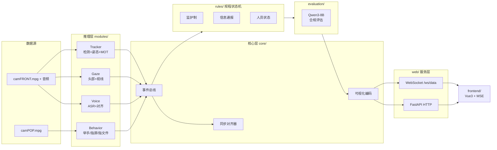

# Hedian · 核电站监护制合规检测系统

> 核电站主控室场景下的多模态合规性实时检测系统：分析 front（正面）与 pop（操作盘）两路音视频，判定操作人 / 监护人是否按规程执行监护制与信息通报，并由大模型对完整流程的多模态证据链进行合规评估，前端流式可视化呈现。

| 后端 | Python 3.10 · FastAPI · Redis Stream+Hash · ffmpeg fMP4 |
|------|------|
| 前端 | Vue 3 · TypeScript · Vite · MSE 流式播放 |
| 感知 | YOLO11 检测 · YOLO26s 姿态 · OC-SORT 跟踪 · Qwen3-ASR 语音对齐 · Qwen3-8B 评估 |
| 代码规模 | 53 个 Python 模块 / 约 10,200 行 · 19 个前端源文件 |

> **刚拿到这份源码？** 先看 [新环境快速上手](#新环境快速上手) —— 那里写清了你手上有什么、还需要补哪些资源、以及在你自己机器上跑通的最短路径，包含**必须修改的本机硬编码路径清单**。

---

## 目录

- [新环境快速上手](#新环境快速上手)
- [系统架构](#系统架构)
- [核心能力](#核心能力)
- [环境要求](#环境要求)
- [准备资源](#准备资源)
- [部署指南](#部署指南)
- [多实例配置](#多实例配置)
- [配置参考](#配置参考)
- [接口参考](#接口参考)
- [项目结构](#项目结构)
- [故障排查](#故障排查)
- [开发说明](#开发说明)
- [许可证](#许可证)

---

## 新环境快速上手

> 面向**第一次拿到本项目源码、要在自己机器上跑起来**的人。如果你本来就在开发机上工作，可跳过本节，直接看 [部署指南](#部署指南)。

### 1. 你拿到的是什么

获取途径不同，拿到的内容差别很大，务必对照下表确认：

| 内容 | `git clone` | 目录整体同步（rsync / 压缩包） | 说明 |
|------|:-----------:|:------------------------------:|------|
| 后端源码 `main.py` `core/` `modules/` `rules/` `evaluation/` `web/` | ✅ | ✅ | 已入库 |
| 默认配置 `config.yaml`、`requirements.txt`、`README.md` | ✅ | ✅ | 已入库 |
| 前端源码 `frontend/src/` 与**已构建产物** `frontend/dist/` | ✅ | ✅ | 产物已入库，不改前端就无需重新构建 |
| 演示配置 `config.5008.yaml`、`config.5009.yaml` | ❌ | ✅ | 未入库，需向项目方索取 |
| 静态码表 `configs/system_code_rules.json` | ❌ | ✅ | **运行必需**（九字码结构校验），需索取 |
| 文档 `docs/`、`AGENTS.md`、`git.md` | ❌ | ✅ | 被 `.gitignore` 排除（`docs/`、`*.md`） |
| 模型权重 `models/` | ❌ | ✅ | 见 [准备资源](#准备资源) |
| 素材与标注 `data/` | ❌ | ✅ | 见 [准备资源](#准备资源) |
| 历史结果 `data/results/` | ❌ | ✅ | 可不要，运行后自动生成 |

> ⚠️ **只 `git clone` 会缺文件**：仓库实际只跟踪 95 个文件，`config.5008.yaml` / `config.5009.yaml`、`configs/`、`docs/`、`AGENTS.md`、`restart_5009.sh`、`models/`、`data/` 均不在其中。
> **推荐做法**：直接向项目方整目录同步（`rsync`），或用 `git clone` 后再补齐上述缺失项。

`models/` 与 `data/` 合计约 26G，其中约 22G 是**公开模型**（Qwen 系列），可以自己下载，不必搬运；真正只有项目方手上才有的约 300M + 自采视频（见下）。

### 2. 需要向项目方索取的资源（体积小，约 300M + 视频）

| 路径（相对 `models/`） | 体积 | 用途 |
|------|------|------|
| `detection/yolo11_MOT.pt` | 103M | 人员检测（含 MOT 跟踪头） |
| `detection/yolo26s-pose.pt` | 24M | 姿态估计 |
| `behavior/behavior_yolo.pt` | 20M | 行为检测 |
| `behavior/behavior_yolo26s-pose.pt` | 24M | 行为姿态估计 |
| `gaze/yolov8n_head.onnx` | 12M | 头部检测 |
| `gaze/gazelle_dinov3_vits16plus_finetuned_1x3x640x640_1xNx4.onnx` | 123M | 视线估计 |
| `voice/qwen/Qwen3-ASR-0.6B-finetuned-v570e` | 1.5G | **微调后的语音识别模型**，`config.5008.yaml` / `config.5009.yaml` 使用它 |

数据侧同理需索取 `data/videos/`、`data/新建文件夹/`、`data/ROI.json`（详见 [视频与标注](#视频与标注--data)）。

### 3. 可自行下载的公开模型（约 20G，按需）

| 路径（相对 `models/`） | 体积 | 来源 |
|------|------|------|
| `evaluation/Qwen3-8B` | 16G | ModelScope / HuggingFace（`Qwen/Qwen3-8B`） |
| `evaluation/Qwen2.5-1.5B-Instruct` | 2.9G | ModelScope / HuggingFace（`Qwen/Qwen2.5-1.5B-Instruct`） |
| `voice/qwen/Qwen3-ASR-0.6B` | 1.8G | ModelScope / HuggingFace（`Qwen/Qwen3-ASR-0.6B`，`config.yaml` 使用） |
| `voice/qwen/Qwen3-ForcedAligner-0.6B` | 1.8G | ModelScope / HuggingFace（`Qwen/Qwen3-ForcedAligner-0.6B`） |

> 暂时不需要大模型评估时，`evaluation/` 下两个模型可以先不下，把对应 `modules.*` / `rules.*` 开关置 `false`，先把感知链路跑通。

### 4. 五步跑起来

```bash
# 1) 建环境（Python 3.10，环境名建议 hedian）
conda create -n hedian python=3.10 -y && conda activate hedian
pip install -r requirements.txt
# 若报 libcudart.so.NN 无法打开，改装带 CUDA 运行时的 torch：
# pip install "torch==2.6.0+cu124" -i https://download.pytorch.org/whl/cu124

# 2) 放资源：按上面两张表补齐 models/；data/ 从项目方同步后放到同名路径

# 3) 改配置：核对 config.yaml 里 videos.* 与 voice.model_path 指向真实文件；
#    单卡机器把 app.gpu_map 中的 "1" 全部改成 "0"

# 4) 启动（前台运行，便于观察日志）
python main.py --gpu 0

# 5) 验证
curl http://127.0.0.1:5002/status     # 期望 {"pipeline":"idle","ws_clients":0}
```

浏览器打开 `http://<你的机器IP>:5002`，点「开始」跑流程。端口由 `app.port` 决定（默认 5002）；仓库另有两套演示配置 `config.5008.yaml` / `config.5009.yaml`，差异见 [多实例配置](#多实例配置)。

### 5. ⚠️ 本机硬编码路径清单（不处理会直接报错）

脚本里有几处写死了原开发机的绝对路径，换机器后必须处理：

| 位置 | 硬编码内容 | 处理方式 |
|------|-----------|----------|
| `restart_5009.sh` 的 `PY=` 一行 | `/home/zhouqing/myconda/envs/hedian/bin/python` | 改成你自己的 python 路径；或直接手敲 `python main.py --config config.5009.yaml --gpu 0` |
| `frontend/build.sh` 的 `_candidates` | `/home/zhouqing/node20/bin`、`/home/wangshengping/node20/bin` | 构建时显式指定：`NODE_BIN=$(dirname $(which node)) ./build.sh` |
| `config.yaml` / `config.5009.yaml` 的 `videos.*` | `data/videos/camFRONT.mpg` 等 | 换成你自己素材的相对路径 |
| `AGENTS.md` 第 4 节示例命令 | 同上 python 绝对路径 | 仅文档示例，不影响运行 |
| Redis 连接 | 默认 `localhost:6379`，`db` 分别 0 / 9 / 10 | 与他人共用同一 Redis 实例时，给每个实例分不同 `db` |

---

## 系统架构



**关键设计点**

- **事件总线解耦**：各推理模块只向总线发布事件，规程状态机被动消费，模块可独立增删。
- **视角级 GPU 分配**：`config.yaml` 按模块指定 GPU，tracker 与 voice/behavior/evaluation 分卡，避免显存争用。
- **推理解耦常驻**：`main.py` 以子进程拉起各推理流，Web 服务常驻；进程异常不影响 HTTP 面。
- **状态可回放**：Redis 记录推理与模块状态，WebSocket 连接时补发状态快照，前端刷新即恢复进度。

---

## 核心能力

| 模块 | 能力 | 说明 |
|------|------|------|
| Tracker | 人员追踪 | 目标检测 + 姿态估计 + 多目标跟踪，输出操作人 / 监护人身份 |
| Gaze | 眼睛关注度 | 头部姿态 + 视线估计，判定是否注视关键区域 |
| Voice | 语音转录 | 字词级时间对齐 + 行业术语归一化，支撑唱票比对 |
| Behavior | 行为检测 | 举手、手指屏幕、手指文件三类关键动作 |
| Rules | 规程判定 | 监护制 / 信息通报 / 人员状态 三大状态机实时研判 + 违规告警；流程子步骤（举手 / 请讲 / 关注 / 通报完毕 / 收到）判定当场逐行下发 |
| Evaluation | 合规评估 | 大模型基于完整多模态证据链输出合规结论与打分；信息通报的团队级逐项判定由规则层确定性给出，大模型仅负责成文 |
| Frontend | 流式可视化 | 视频、字幕、关注度热力图、流程事件流、告警实时推送，断点续看 |

---

## 环境要求

| 组件 | 要求 |
|------|------|
| Python | 3.10 |
| GPU | NVIDIA + CUDA，建议单卡 24GB 起；默认配置按视角分卡 |
| Redis | 6.x+，需支持 Stream 与 Hash |
| Node | ≥18（20 验证通过；仅前端构建阶段，系统自带 v12 会失败） |
| ffmpeg | 系统可用，需含 libx264（fMP4 转封装） |

---

## 准备资源

> 以下资源不包含在 Git 仓库内，需按指定路径自行准备。判定逻辑的权威来源为 `rules/` 源码，规程细则与设计文档需向项目方单独获取。

### 静态码表 → `configs/`

| 路径 | 说明 | 获取方式 |
|------|------|----------|
| `configs/system_code_rules.json` | 九字码（设备码）结构校验用的系统码 / 设备类型码表，由 `voice.system_code.rules_path` 指定。缺失时语音设备码矫正直接失效 | 项目方提供 |

### 模型权重 → `models/`

| 路径（相对 `models/`） | 体积 | 用途 | 来源 |
|------|------|------|------|
| `detection/yolo11_MOT.pt` | 103M | 人员检测（含 MOT 跟踪头） | 项目方提供 |
| `detection/yolo26s-pose.pt` | 24M | 姿态估计 | 项目方提供 |
| `behavior/behavior_yolo.pt` | 20M | 行为检测 | 项目方提供 |
| `behavior/behavior_yolo26s-pose.pt` | 24M | 行为姿态估计 | 项目方提供 |
| `gaze/yolov8n_head.onnx` | 12M | 头部检测 | 项目方提供 |
| `gaze/gazelle_dinov3_vits16plus_finetuned_1x3x640x640_1xNx4.onnx` | 123M | 视线估计 | 项目方提供 |
| `voice/qwen/Qwen3-ASR-0.6B-finetuned-v570e` | 1.5G | 微调语音识别（`config.5009.yaml` 使用） | 项目方提供 |
| `voice/qwen/Qwen3-ASR-0.6B` | 1.8G | 语音转录基座（`config.yaml` 使用） | 公开模型 |
| `voice/qwen/Qwen3-ForcedAligner-0.6B` | 1.8G | 字词级对齐 | 公开模型 |
| `evaluation/Qwen3-8B` | 16G | 合规评估主模型 | 公开模型 |
| `evaluation/Qwen2.5-1.5B-Instruct` | 2.9G | 备用评估模型 | 公开模型 |

- **公开模型**（Qwen 系列）可从 ModelScope / HuggingFace 获取，目录名须与上表**完全一致**（含大小写与点号）。
- **项目方提供**（YOLO 系列与 `*-finetuned-*` 语音模型）为项目训练产物，无法自行下载，需向项目方索取。

> ⚠️ **目录名必须与配置严格对应**：`voice.model_path` / `voice.aligner_path` 的取值就是上表的目录名。**三套配置指向的语音模型不同**——`config.yaml` 用基座 `Qwen3-ASR-0.6B`，而 `config.5008.yaml` 与 `config.5009.yaml` 都用微调版 `Qwen3-ASR-0.6B-finetuned-v570e`。目录缺失或拼写不符会在启动时直接报路径不存在。

### 视频与标注 → `data/`

| 路径（相对 `data/`） | 体积 | 说明 |
|------|------|------|
| `videos/camFRONT.mpg` | 86M | 正面视角视频（30fps，操作人 / 监护人入镜），`config.yaml` 使用 |
| `videos/camPOP.mpg` | 67M | 操作盘视角视频（25fps），`config.yaml` 使用 |
| `videos/camFRONT_audio.wav` | 20M | 正面视角音频轨 |
| `videos/ex_53m_360.mp4` | 54M | 备用短片素材（可选） |
| `新建文件夹/信息通报_camFRONT_01.mp4` 等 | 666M | 信息通报场景双视角样本（`_01`~`_05`），`config.5009.yaml` 用 `_01` 这组 |
| `ROI.json` | 2M | 关键区域标注，关注度判定的依据 |
| `results/` | — | 推理结果输出目录（需可写），可留空，运行后自动生成，无需索取 |

样本数据为本项目自采，无法随仓库发布，需向项目方索取。替换为自有视频后须同步修改对应配置的 `videos.*`。

### Redis 实例

`/start`、`/stop`、`/reset` 只清理**本项目命名空间**的 key（`inference:*` / `pipeline:*` 删除，`module:events:*` 仅 `XTRIM` 清历史条目、保留 key 与消费组），不执行 `flushdb`，因此可与其它实例共用 Redis 实例；多实例并存时建议各自指定不同的 `redis.db`（CLI `--redis-db`）。

---

## 部署指南

### 1. 获取代码

三种途径任选其一，后续命令均在**仓库根目录**执行：

```bash
# a) 从 Git 仓库克隆（★ 仓库只含 95 个文件：代码 + config.yaml + README + frontend/dist；
#    缺 config.5008/5009.yaml、configs/、docs/、models/、data/，需另行索取）
git clone <repo-url> && cd A_DemoSrc

# b) 从项目方服务器同步（推荐：内容完整、支持断点续传）
rsync -avP <用户名>@<服务器IP>:/path/to/A_DemoSrc/ ~/A_DemoSrc/

# c) 已有压缩包
tar -xf A_DemoSrc.tar.gz && cd A_DemoSrc
```

> - 只要代码、不要 24G 权重时给 rsync 加 `--exclude='models/' --exclude='data/'`，再按 [准备资源](#准备资源) 自备权重。
> - 两种途径拿到的文件差异，见 [新环境快速上手](#新环境快速上手) 第 1 节对照表。

### 2. 安装依赖

```bash
conda create -n hedian python=3.10 -y
conda activate hedian
pip install -r requirements.txt
```

> 版本已锁定（Python 3.10 / CUDA 12.4 / torch 2.6.0）。若导入 torch 报 `libcudart.so.NN` 无法打开，改装带 CUDA 运行时的轮子：
> `pip install "torch==2.6.0+cu124" -i https://download.pytorch.org/whl/cu124`

### 3. 放置资源

按 [准备资源](#准备资源) 补齐 `models/` 与 `data/`，并核对配置中所有路径指向真实文件——尤其是 `voice.model_path`（**不同配置指向不同语音模型**）。资源未备齐时，可先用 `modules.*` / `rules.*` 开关关掉对应模块。

### 4. 启动后端

```bash
python main.py --gpu 0                            # 默认 config.yaml（端口 5002）
python main.py --config config.5009.yaml --gpu 0  # 指定配置（端口 5009）
```

常驻部署：

```bash
setsid nohup python main.py --gpu 0 > hedian.log 2>&1 < /dev/null &
```

> **单卡机器**务必先把 `app.gpu_map` 中的 `"1"` 全部改为 `"0"`，否则 voice / behavior / evaluation 子进程会因找不到 GPU1 而启动失败。
> 重启 5009 实例也可直接用 `./restart_5009.sh`，但注意其中的 python 路径是原开发机硬编码，需先修改（见 [新环境快速上手](#新环境快速上手) 第 5 节）。

### 5. 构建前端（仅改动前端源码时需要）

```bash
cd frontend
./build.sh                        # 自动探测 Node 18+；或 NODE_BIN=/path/to/node/bin ./build.sh
# 等价手动方式：
npm install && npm run build
```

- **必须使用 Node 18 及以上**（本项目在 Node 20 验证通过）。系统自带的 Node v12 不支持可选链、top-level await，构建会直接失败。
- `build.sh` 内置的候选路径含原开发机目录，换机器后请用 `NODE_BIN=$(dirname $(which node)) ./build.sh` 显式指定。
- 仓库已自带 `frontend/dist/` 构建产物，**不改前端就无需执行本步**。
- 构建产物由后端以静态文件兜底方式托管，无需独立部署 Web 服务器。

### 6. 验证

```bash
curl http://127.0.0.1:5002/status      # 期望 {"pipeline":"idle", "ws_clients":0}
curl -X POST http://127.0.0.1:5002/start
curl http://127.0.0.1:5002/api/modules  # 确认各模块开关
```

浏览器访问 `http://<服务地址>:5002`。

### 停止 / 复位

```bash
curl -X POST http://127.0.0.1:5002/stop    # 终止推理子进程，切回 idle
curl -X POST http://127.0.0.1:5002/reset   # 同时清空 Redis 与可视化缓存
pkill -f main.py                            # 直接结束服务
```

---

## 多实例配置

仓库提供三套配置，可同时运行、互不干扰。差异如下：

| 配置 | 端口 | Redis db | 输入视频 | 语音模型 | 启用范围 |
|------|------|----------|----------|----------|----------|
| `config.yaml` | 5002 | 0 | `data/videos/camFRONT.mpg` + `camPOP.mpg` | 基座 `Qwen3-ASR-0.6B` | 四大规程与全部感知模块开启 |
| `config.5008.yaml` | 5008 | 9 | 同上 | 微调 `Qwen3-ASR-0.6B-finetuned-v570e` | 同上（与 `config.yaml` 仅端口 / db / 语音模型三处差异） |
| `config.5009.yaml` | 5009 | 10 | `data/新建文件夹/信息通报_camFRONT_01.mp4` + `camPOP_01.mp4` | 微调 `Qwen3-ASR-0.6B-finetuned-v570e` | 只评判信息通报；`personnel_status` 关闭；evaluation 落在 GPU0 |

选择方式：`python main.py --config config.5009.yaml --gpu 0`；不指定 `--config` 时使用 `config.yaml`。

注意事项：

- **端口与 `redis.db` 必须互不相同**，否则两个实例的事件流会互相串台，表现为前端画面/字幕错乱。
- `config.5009.yaml` 把 `evaluation` 放在 GPU0，是因为 GPU1 常被训练进程占用十余 GB，Qwen3-8B（bf16 约 12G）在上面加载必然 OOM，报告正文会变成一整段 traceback。
- 三套配置的 `videos.*` 指向不同素材，运行前请确认对应文件已就位。

---

## 配置参考

下表为 `config.yaml` 的主要字段；`config.5008.yaml` / `config.5009.yaml` 的差异见 [多实例配置](#多实例配置)。

| 字段 | 默认 | 说明 |
|------|------|------|
| `app.port` | `5002` | Web 服务端口；5008 / 5009 见 [多实例配置](#多实例配置) |
| `app.gpu_map` | 按模块分卡 | **单卡环境请将值 `"1"` 改为 `"0"`** |
| `app.gpu_default` | `"0"` | `gpu_map` 未覆盖模块的回退值，含 CLI `--gpu` |
| `app.fps` | `30.0` | 帧率基准 |
| `redis.host` / `port` / `db` | `localhost` / `6379` / `0` | Redis 连接；多实例并存须各用不同 `db`（5008→9、5009→10） |
| `paths.data_root` | `data` | 数据根目录 |
| `paths.model_root` | `models` | 模型根目录 |
| `paths.result_root` | `data/results` | 结果输出目录 |
| `videos.front` / `pop` | 见仓库 | 输入视频路径；**三套配置指向不同素材**，换素材后必须同步修改 |
| `voice.asr_engine` | `qwen3` | 语音识别引擎 |
| `voice.model_path` / `aligner_path` | 见仓库 | 语音模型路径；`config.yaml` 与 5008 / 5009 指向**不同**的 ASR 目录，须与磁盘实际目录名一致 |
| `supervision.*` | 见仓库 | 监护制绑定的时长与距离阈值、连续帧数、告警冷却 |
| `tracker.detection.*` | 见仓库 | 检测置信度、NMS、输入尺寸 |
| `gaze.*` / `behavior.*` | 见仓库 | 关注度与行为判定的置信度、IoU、冷却参数 |
| `bus.max_queue_size` | `1024` | 事件总线队列上限 |
| `modules.*` | `true` | 各感知模块开关，未备齐资源的模块可置 `false` |
| `rules.*` | `true` | 各规程状态机开关 |

---

## 接口参考

### HTTP

| 方法 | 路径 | 说明 |
|------|------|------|
| POST | `/start` | 启动流水线。幂等：运行中重复调用返回 `already_running`；启动前清理本项目 Redis 残留（不 `flushdb`） |
| POST | `/stop` | 终止推理子进程，清理本项目 Redis 残留（`inference:*` / `pipeline:*` / `module:events:*` trim），状态切回 idle |
| POST | `/reset` | 页面刷新场景：终止进程 + 清理本项目 Redis 残留 + 清空可视化缓存 |
| GET | `/status` | 返回 `{pipeline, ws_clients}` |
| GET | `/api/config` | 返回当前生效的完整配置 |
| GET | `/api/modules` | 返回模块开关 |
| GET | `/api/video/front` | 流式下发正面视角视频（HTTP Range 206 硬解） |
| GET | `/api/video/pop` | 流式下发操作盘视角视频 |

静态资源兜底至前端 `dist/`，并强制 `no-cache` 响应头，避免部署后取到旧产物。

### WebSocket `ws://<host>:5002/ws/data`

- **下行**：服务端推送推理事件、字幕、关注度、告警与流程事件（流程开始 / 子步骤判定 / 流程结束）数据；连接建立时补发状态快照，刷新页面即可恢复进度。
- **上行**：客户端上报播放进度 `{ "type": "playback_progress", "current_sec": 12.5 }`，用于多端同步。

---

## 项目结构

```
├── main.py                 # 入口：拉起推理子进程 + Web 常驻
├── config.yaml             # 默认配置（端口 5002）
├── config.5008.yaml        # 演示配置（端口 5008 / redis db9 / 微调 ASR）
├── config.5009.yaml        # 演示配置（端口 5009 / redis db10 / 信息通报双视角）
├── restart_5009.sh         # 5009 实例重启脚本（内含本机 python 绝对路径，换机需改）
├── requirements.txt        # Python 依赖（版本锁定）
├── README.md               # 本文档
├── AGENTS.md               # AI 协作指引（含改动禁区清单，改代码前必读）
│
├── configs/                # 静态码表（system_code_rules.json，九字码结构校验用）
├── core/                   # 事件总线 / 推理流 / 同步对齐 / 可视化编码
├── modules/                # 感知层：voice / tracker(+gaze) / behavior
├── rules/                  # 规程状态机：监护制 / 信息通报 / 人员状态
├── evaluation/             # 评估层：大模型评估 / 数据提取 / 流程管理
├── web/                    # 服务层：HTTP / WebSocket / 可视化转发
├── docs/                   # 设计文档（ARCHITECTURE / API / SPEC）与业务规则 rule_doc/
│
├── frontend/
│   ├── build.sh            # 前端构建脚本（要求 Node 18+，可 NODE_BIN 指定）
│   ├── dist/               # 构建产物（已入库，后端静态托管；不改前端无需重建）
│   ├── src/media/          # MSE 缓冲 / 播放调度 / 同步 / 保留窗口 / 指标
│   ├── src/composables/    # 字幕、播报、滚动、报表、打字机等组合式逻辑
│   ├── src/components/     # 视频 / 语音 / 告警 / 报表 / 头部面板
│   └── src/api/            # 管线接口封装
│
├── models/                 # 模型权重（自备，清单见「准备资源」）
└── data/                   # 视频与结果（自备）
    ├── videos/             # camFRONT.mpg / camPOP.mpg / camFRONT_audio.wav
    ├── 新建文件夹/          # 信息通报双视角样本（5009 配置使用）
    ├── ROI.json            # 关注度判定区域标注
    └── results/            # 推理结果输出目录（可留空，运行后自动生成）
```

---

## 故障排查

| 现象 | 排查方向 |
|------|----------|
| 启动即报模型路径不存在 | 核对 `voice.model_path` / `aligner_path` 与磁盘实际目录名是否**逐字符一致**（含点号，如 `Qwen3-ASR-0.6B`）；注意 5008 / 5009 指向的是 `Qwen3-ASR-0.6B-finetuned-v570e` |
| 启动报 `restart_5009.sh`: python 不存在 | 脚本内 `PY=` 是原开发机绝对路径，按 [新环境快速上手](#新环境快速上手) 第 5 节修改 |
| 前端构建报语法错误（`?.` / top-level await） | 误用系统自带 Node v12；改用 Node 18+：`NODE_BIN=$(dirname $(which node)) ./build.sh` |
| 公开模型下载后加载报结构缺失 | 需整目录下载（含 `config.json` / `tokenizer*` / `*.index.json`），不要只拉单个 `.safetensors` |
| `/api/video/front` 返回 404 | 配置中 `videos.front` 指向的文件不存在（如缺 `data/videos/camFRONT.mpg`） |
| 显存溢出 / 进程被杀 | 未做单卡改造：把 `gpu_map` 中的 `"1"` 改为 `"0"`，或关闭 `modules.*` 中的高耗模块；Qwen3-8B bf16 约需 12G 显存 |
| 评估报告正文变成一整段 traceback | 评估子进程 CUDA OOM（常见于目标卡被训练任务占用），把 `evaluation` 指到空闲卡 |
| 前端刷新后进度丢失 | Redis 连接失败；检查 `redis.*` 与实例可用性 |
| 前端一直转圈 | 后端未在运行，或端口与 `app.port` 不一致 |
| 两个实例画面 / 字幕串台 | 端口或 `redis.db` 冲突，按 [多实例配置](#多实例配置) 分配 |
| 告警阈值不符合现场 | 调整 `supervision.*`、`gaze.*`、`behavior.*` 阈值后重启 |
| 取到旧版前端 | 确认已重新 `build.sh`，且产物位于后端静态兜底目录 |

---

## 开发说明

- **依赖变更**：修改 `requirements.txt` 后需在干净环境验证一次完整启动。
- **配置变更**：新增运行参数须同步写入本 README 的配置参考表，避免文档与实现漂移；同一参数若在 `config.5008.yaml` / `config.5009.yaml` 中另有取值，须一并同步。
- **新增依赖文件**：`configs/`、`docs/` 等被 `.gitignore` 排除或未提交的资源，变更后需提醒协作者重新整目录同步，避免对方拿到过期版本。
- **新增模块**：在 `modules/` 下实现并发布事件，在 `config.yaml` 增加 `modules.*` 开关，本 README 的能力表同步补充。
- **接口变更**：新增或调整 HTTP / WebSocket 契约，须同步更新上方接口参考表。
- **提交规范**：遵循 Conventional Commits，如 `feat(rules): ...`、`fix(web): ...`、`docs(readme): ...`。

---

## 许可证

Internal project. 未经许可不得外传。
